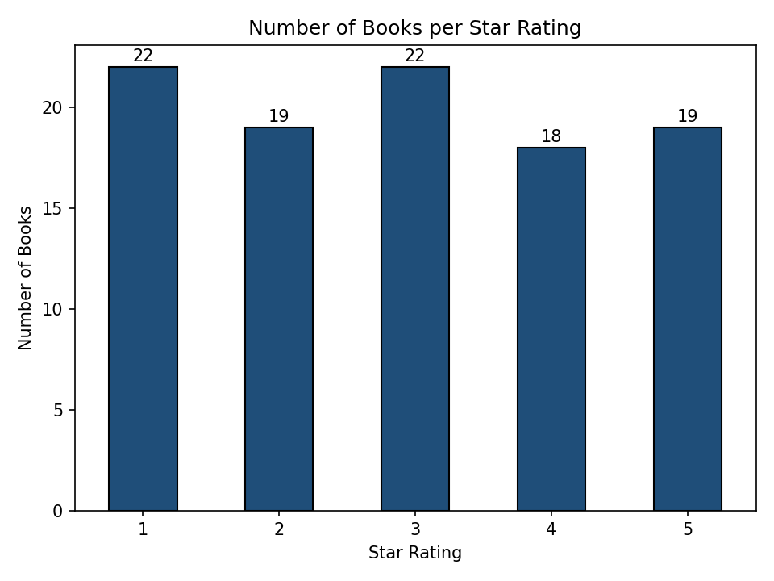

# Bookstore Intelligence Scraper

A Python web scraper that turns [books.toscrape.com](https://books.toscrape.com/) into a clean business dataset, then uses the data to decide which books a competing online bookstore should sell.

Built for Assignment 2 of Business Data and Text Mining (BS Business Analytics, FAST-NUCES Islamabad).

## What it does

1. Downloads each catalogue page with `requests`
2. Parses all 20 product cards per page with `BeautifulSoup`
3. Extracts the title, price, star rating, stock status and product URL
4. Converts ratings from words ("Three") to numbers (3)
5. Loops over 5 pages with one reusable function, giving 100 books
6. Saves the dataset to `competitor_books.csv`
7. Answers 7 business questions about price and rating
8. Solves a £100 budget challenge with a 0/1 knapsack algorithm
9. Plots the number of books at each star rating

## HTML elements used

| Data | Element |
|---|---|
| Book card | `article.product_pod` |
| Title | `h3 > a`, `title` attribute |
| Price | `p.price_color` |
| Rating | `p.star-rating` (second class: One to Five) |
| Availability | `p.instock.availability` |

## Key findings

| Question | Answer |
|---|---|
| Most expensive | The Death of Humanity: and the Case for Life (£58.11) |
| Cheapest | Patience (£10.16) |
| Average price | £34.56 |
| 5-star books | 19 of 100 |
| In stock | 100% |
| Cheapest 5-star book | Princess Between Worlds (£13.34) |

5-star books have the lowest average price (£30.01), below the overall average.

## £100 challenge

| Method | Books | Cost | Total stars |
|---|---|---|---|
| Greedy (cheapest 5-stars first) | 6 | £95.28 | 30 |
| 0/1 knapsack (optimal) | 7 | £98.80 | 31 |

Buying only the top-rated books first isn't the best use of a fixed budget. Mixing in a few cheaper 3 and 4-star books fits one more book in and gives a higher total.



## How to run

Open the notebook in Google Colab and run all cells, or run it locally:

```bash
pip install requests beautifulsoup4 pandas matplotlib
```

## Files

* `Noor_Bookstore_Scraper.ipynb`: the scraper and analysis
* `competitor_books.csv`: the dataset produced by the scraper
* `rating_counts.png`: rating distribution chart
